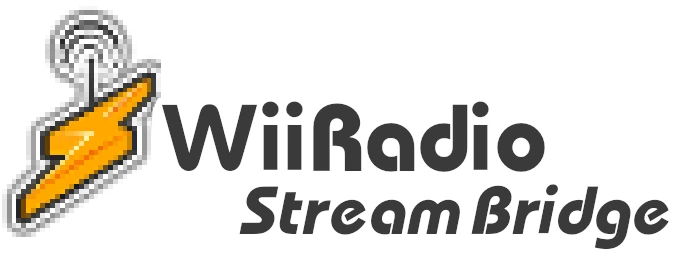
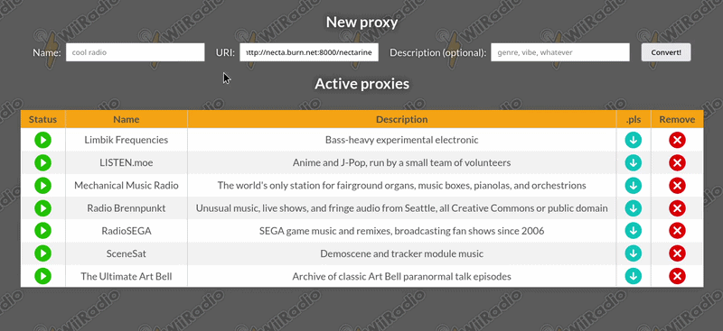

# 

WiiRadio is a long-abandoned, yet wonderful, homebrew application for the Nintendo Wii that allows users to listen to internet radio streams.  

The SHOUTcast search functionality has been deprecated for quite a while now, rendering the main purpose of the application to be the playback of pre-downloaded `.pls` or `.m3u` files. However, many of these files found in the present day will not run properly in WiiRadio.  

Modern internet radio often uses HTTPS and audio codecs that WiiRadio cannot understand. This tool provides a lightweight web interface to take any modern stream, transcode it into Wii-compatible audio using FFmpeg, and broadcast it over local HTTP via a bundled Icecast server.  

## Features

- **WebUI**: Simple interface to add, pause, resume, and remove streams  
- **On-the-fly transcoding**: Uses FFmpeg (`libmp3lame`) to convert incoming audio to 44.1 kHz MP3 streams at a bitrate of your choosing, up to 128 kbps  
- **Automatic bitrate matching**: Leave the bitrate on *Auto* and the source is measured first, so a 32 kbps talk stream isn't blown up to 128 kbps and made three times harder for the Wii to keep up with  
- **Self-healing streams**: FFmpeg reconnects to the source by itself when a station drops the connection, and a transcode that dies outright is restarted automatically with a backoff — no more paused streams waiting to be noticed  
- **Playlist generation**: Automatically generates `.pls` playlist files for immediate playback in WiiRadio
- **Persistent across reboots**: Any stream running when the program exits will be stored in a local JSON file
- **Dockerized and lightweight**: Runs entirely in two containers  



## Prerequisites

- Docker and Docker Compose

## Installation

1. Clone the repository:  
```bash
git clone https://github.com/cmyksoda/wiiradio-stream-bridge.git
cd wiiradio-stream-bridge
```

2. Open `docker-compose.yml` and set your local IP address in the `HOST_IP` environment variable. Optionally, you can change the default Icecast passwords in both `docker-compose.yml` and `server.js`.  

## Usage

1. Start the containers:  
```bash
docker compose up --build -d
```  
2. Open your browser and navigate to `http://localhost:3000` to access the conversion utility.  
3. Enter a name, your target stream URI, and, optionally, a description.  
4. Pick a bitrate, or leave it on **Auto** to match the source. Click convert!  
5. Once the stream starts, click the download icon in the active proxies table to grab the `.pls` file, then place it in the `/apps/radiow/data/pls/` folder on your SD card.  
6. The proxy will serve the transcoded audio continuously over port 4000.

*Note: The server is coded to only allow 20 concurrent streams to play at any given time, with the last played stream paused when a new stream is added. You **can** change this functionality by modifying the* `const MAX_STREAMS = 20;` *line near the top of* `server.js` *, but this limitation was included simply to help with performance.*  

## If a stream keeps cutting out

WiiRadio reports a failed stream whenever its connection goes away, and the usual
cause is Icecast dropping the Wii rather than anything wrong with the source. Check
the Icecast log for it:

```bash
docker exec icecast-server grep "fallen too far behind" /var/log/icecast/error.log
```

Each of those lines is the Wii having stalled for longer than Icecast's `queue-size`
buffer covers, at which point Icecast hangs up on it. `docker-compose.yml` raises
that buffer to 2 MB (about two minutes of slack at 128 kbps) for this reason. Wii
wifi is not fast, so if the lines keep appearing, lower the stream's bitrate — every
halving doubles how long the Wii can stall before Icecast gives up on it.

## Known Bugs

- ~~Currently, metadata display in WiiRadio is iffy at best. [Progress will be updated here](https://github.com/cmyksoda/wiiradio-stream-bridge/issues/1)~~ *fixed! open an issue please if you find any problems I haven't!*

## Credits

- **WiiRadio** by Scanff, Knarrff, and everyone else who has worked on it, without whom this project wouldn't exist ([scanff/wiiradio](https://github.com/scanff/wiiradio))
- The lightning bolt/radio tower icon and the WebUI background, designed by TiMeBoMb of the original WiiRadio team
- The CSS for the active proxies table, taken and modified from [this post](https://forum.obsidian.md/t/custom-css-for-tables-5-new-styles-ready-to-use-in-your-notes/17084) by DeaconLight on the Obsidian Forums
- **Wii Sans** by [NotSoArtisty on DeviantArt](https://www.deviantart.com/notsoartisty/art/Wii-Sans-v2-824335667), used in the lower half of the logo
- **Recommended Radio Streams** by Deroverda ([recommended-radio-streams](https://github.com/deroverda/recommended-radio-streams)), a great collection of curated internet radio streams that I highly recommend
- **FFmpeg** by the FFmpeg developers, with the LAME encoder (`libmp3lame`), for transcoding streams to MP3
- **Icecast** by the Xiph.Org Foundation, for broadcasting the streams, run from the [infiniteproject/icecast](https://hub.docker.com/r/infiniteproject/icecast) Docker image
- **Express** by TJ Holowaychuk and contributors, for the web server
- **Lato** by Łukasz Dziedzic, the typeface of the WebUI, loaded from Google Fonts

## License

All parts of this repository that are my work are licensed under the [GNU General Public License, version 3 or later](LICENSE).

---

*This project was made with AI assistance. For more information, see [my AI usage statement](https://github.com/cmyksoda/cmyksoda/blob/main/AI_USAGE.md).*
